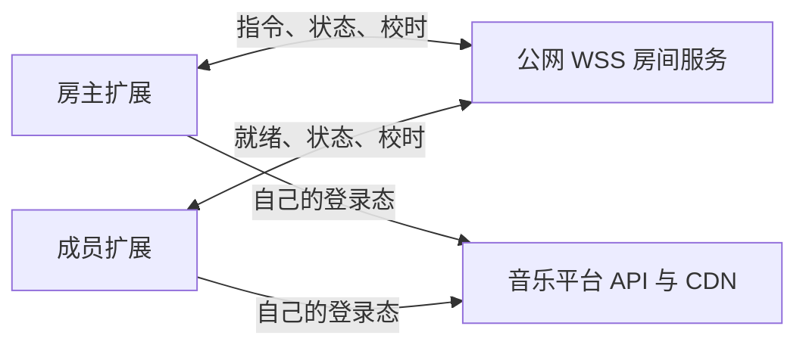

# 一起听：可行性与建议方案

调研日期：2026-10-23。本文是基于当前仓库和官方文档的设计建议，尚未实现房间服务，也未实测多人同步精度。

## 结论与首版范围

**可行，建议采用「服务端同步播放状态、每位成员独立获取音源」的方案。** 现有 Provider、播放器和 Media Session 可以复用；主要工作是播放器控制入口改造、房间协议及服务部署，属于跨前后端功能。

建议首版支持桌面 Chrome 扩展、2–5 人私密房间、房间码加入、房主控制播放 / 暂停 / 跳转 / 切歌 / 队列，成员独立调音量。加入中的成员先自行获取音源，再追上房间进度。首版以相同 Provider + 歌曲 ID 播放为前提。

暂不包含跨音源自动匹配、语音聊天、平台官方「一起听」房间互通、房主转移，以及关闭扩展页面后继续播放。移动网页可作为后续兼容目标，不能承诺锁屏后持续接收同步指令。

## 当前代码具备什么，缺少什么

| 位置 | 现状 | 对一起听的影响 |
| --- | --- | --- |
| `client/composables/player.ts` | 模块级 `new Audio()`，已有取源、播放 / 暂停、跳转、切歌和队列 | 可复用播放引擎；需拆开准备音源和开始播放 |
| 同上 | `ended` 自动切歌，本地生成随机顺序，`setPlayQueue()` 会立即播放 | 房间中只能由房主决定下一首，成员不能各自随机和自动切歌 |
| 同上 | `sourceRevision` / `playIntent` 阻止过期取源及播放请求 | 可沿用，并增加房间版本与本次播放实例标识 |
| `client/composables/media-session.ts` | 系统媒体按键直接调用播放器函数 | 页面、右键菜单、队列和系统媒体按键都要经过同一控制入口 |
| `client/composables/player-persistence.ts` | 保存个人队列和播放位置 | 加入房间前保存个人状态，房间状态独立存放，离开时恢复 |
| `shared/utils/providers/` | 按本机登录态获取第三方音源 | 每位成员仍使用自己的会话；可能有人不能播放 |
| `shared/types/music-info.ts` | `MusicInfo` 可以携带 `src`，`SourceInfo` 包含 URL / 请求头 | 不能直接把这些对象序列化发送到房间，必须定义独立的允许字段集合 |
| `entrypoints/background.ts` | 只处理打开页面和扩展安装 | 当前没有后台音频或房间连接；关闭应用页会停止播放 |
| `vite.config.ts` / `package.json` | Nitro 插件已注释，无 `dev` 脚本，服务端测试项目也已注释 | `server/` 虽存在，当前默认构建并未接入它；需要补服务端启动、构建和部署 |
| `nitro.config.ts` | 未启用 WebSocket | 需增加配置及路由，先验证当前安装版本的运行行为 |

注意：README 和部分旧笔记仍描述 Vite + Nitro 一体构建，实施时应以当前配置为准。

扩展模式直接让媒体元素加载 CDN，能够利用浏览器缓冲和 Range；非扩展模式目前会先下载完整 Blob，再设置媒体源。因此网页模式的首次加载等待可能更长，需要单独验证。

## 为什么推荐 WebSocket 房间服务



| 方案 | 判断 |
| --- | --- |
| WebSocket + 集中房间状态 | 推荐：双向小消息，服务端统一排序，重连容易取得完整快照 |
| SSE + HTTP 指令 | 也可行，但要维护两条通道，本场景没有明显收益 |
| WebRTC DataChannel | 状态同步不需要它的媒体传输能力；仍需信令，增加连接协商与网络穿透工作 |
| 房主转发音频流 | 改变现有取源与播放模型，带宽和兼容性成本更高，首版不采用 |

WebRTC 仍需要交换信令来建立连接，参见 [MDN WebRTC connectivity](https://developer.mozilla.org/en-US/docs/Web/API/WebRTC_API/Connectivity)。因此它不能直接解决「完全没有服务端」的问题。

当前安装的 Nitro 是 `3.0.260903-beta`，本地类型声明已有 `features.websocket`。官方文档提供 `features.websocket: true` 和从 `nitro` 导入的 `defineWebSocketHandler`，可优先复用，见 [Nitro WebSocket](https://nitro.build/docs/websocket)。具体配置与运行结果仍须以该已安装版本的最小实验确认，不能直接照搬 Nitro 2 的教程。

建议给房间服务增加独立运行 / 构建入口，与 WXT 分开部署，不必为此同时恢复整个网页代理部署。异地成员需要共同可访问的公网 HTTPS / WSS 地址，仅运行某个人电脑上的 localhost 不够。

首版用一个常驻 Node 进程和内存房间即可，重启后房间失效并明确提示用户。上线前确认反向代理允许 WebSocket Upgrade、长连接超时与 TLS；普通短时 HTTP 函数不能默认视为适合房间服务。多实例以后再加房间归属、共享存储及广播；仅加 Redis 发布订阅不能代替房间指令的统一排序。

服务器只传控制消息，不承担音乐流量，资源需求主要随在线连接数、队列大小和消息频率增长；实际费用取决于部署平台和规模，本次未估算报价。

## 同步协议和进度计算

服务端保存一份权威状态，房主提交意图，服务端验证权限后生成新版本并广播。建议至少包含：

- 房间 / 会话标识、协议版本、单调递增 `revision`、房主身份与成员状态。
- 队列项目的唯一 `queueItemId`、`provider`、歌曲 `id` 和必要展示字段。
- 本次播放的 `playbackId`：重复播放同一首时也变化，避免旧的取源 / 就绪消息污染新播放。
- `status`、`positionAtAnchor`、`anchorServerTime`、`rate`、当前队列项目、播放模式。
- 指令 `commandId`、预期版本及确认 / 拒绝结果，用于去重与处理过期操作。

进度单位统一为秒，时间戳统一为毫秒。播放时目标进度为：

```text
目标进度 = positionAtAnchor
         + (估计的当前服务器时间 - anchorServerTime) / 1000 * rate
```

暂停时保持锚点进度；尚未到约定开始时刻时不提前播放。不能直接相信客户端 `Date.now()` 相同，也不能收到一次网络消息就认定两端同时播放。通过多次往返校时取低 RTT 样本估计偏移，本地用 `performance.now()` 推进估计；重连、恢复页面和系统唤醒后重新校时。

建议流程：

1. 用户点击加入，服务器返回最新状态；客户端在用户操作中尝试启用播放，并独立解析音源。
2. 客户端上报 `ready`、等待、自动播放受阻或无权限。已有房间继续播放，新成员准备好后追上；首播 / 切歌时房主就绪即可启动，其他人晚到追上，避免一人拖住所有人。
3. 服务端根据房主的就绪与指令发布带未来开始时刻的状态；所有人预先 seek，在约定时间尝试播放，实际启动后再校正。
4. 客户端周期性比较 `audio.currentTime` 与目标位置，按误差修正；前台恢复和重连后立即拉快照，再比较位置。
5. 成员音频结束后等待房间决定，不能本地切歌。房主的实际结束事件推动服务端更新下一首；歌曲加载失败时显示失败，不声称已经播放。

漂移校正的实验起点：误差小于约 150ms 不处理，150–500ms 可短时用 `0.98–1.02` 倍速追赶，大于 500ms 才 seek，并设置滞回和冷却，避免来回跳动。具体阈值必须实测调整，所有校正都受当前 `revision` / `playbackId` 约束。临时倍速是本地校正，不广播成房主改速；离开房间恢复原速。

`playbackRate` 可调速，浏览器提供音高校正，见 [MDN playbackRate](https://developer.mozilla.org/en-US/docs/Web/API/HTMLMediaElement/playbackRate)。这种方法仍需测听感、seek 延迟和设备表现。蓝牙等输出延迟不包含在 `audio.currentTime` 里，不能把媒体进度接近等同于扬声器真正同时发声。

建议把「稳定网络下两端媒体时间差多数落在 300ms 内」作为原型验证目标，记录分位数和恢复耗时；这是待验证目标，不是现有能力或精度承诺。同一房间多台扬声器无回声的精确同步不在首版目标内。

## 音源与浏览器限制

### 各自的播放权限和内容一致性

房间只能同步歌曲身份与进度，不能让成员继承房主的登录、会员和地域权限。当前网易云 Provider 已将 `freeTrialInfo` 映射为「试听」音质，QQ 对无可用音质返回错误；房间需把这些结果展示为成员不可同步的原因。

建议 Provider 增加结构化的完整 / 试听 / 不可播放状态及可用区间，避免依赖「试听」文案判断。时长比较只能辅助发现差异，不能证明音频内容一致；完整曲和从歌曲中段开始的试听片段不能按同一时间轴同步。

首版不自动用另一个音源替换：不同版本、前奏、静音、现场录音会导致同一个时间点对应不同内容。队列共享仅发送白名单字段，**不发送 `src`、`SourceInfo`、签名音频 URL、Cookie、第三方请求头或登录凭据**。每台设备继续通过既有 Provider 和 `shared/utils/fetch.ts` 获取第三方数据。

### 自动播放与系统媒体控制

加入房间应提供明确的「加入并播放」操作，但一次点击不能保证后续异步播放都被浏览器放行。必须处理 `play()` 的拒绝，提示用户再次点击继续，而不是把受阻成员标记成已同步。脚本调用也受自动播放策略约束，见 [MDN play()](https://developer.mozilla.org/en-US/docs/Web/API/HTMLMediaElement/play)。

Media Session 的房主操作应生成房间指令。普通成员的系统暂停 / 停止应允许本机暂停并标记「暂离同步」，再次播放时追到房间当前位置；不能拦住系统暂停，也不能让成员暂停意外暂停整个房间。成员的切歌 / 跳转等房间控制在首版不可用，界面给出房主控制提示。

### 后台、锁屏和关闭页面

Media Session 提供系统媒体控制，不是 JavaScript 后台运行保证。页面被冻结后，定时器等任务可能停止，因此 WebSocket、Worker 或高频计时器都不能保证移动浏览器锁屏后持续同步。见 [Chrome Page Lifecycle](https://developer.chrome.com/docs/web-platform/page-lifecycle-api)。需要在恢复后补快照、重新校时和追赶进度；长期后台可靠同步需要单独评估原生容器及目标系统后台能力。

桌面扩展若后续要求「关掉应用页仍在房间播放」，需将音频引擎迁到 offscreen document，并设计消息控制、会话恢复和 Media Session 所在上下文。Chrome 的 `AUDIO_PLAYBACK` offscreen 在连续 30 秒没有音频播放后会关闭，暂停房间也要能正确恢复，见 [Chrome Offscreen API](https://developer.chrome.com/docs/extensions/reference/api/offscreen)。

Chrome 116 起 service worker 可通过 30 秒活动窗口内交换 WebSocket 消息延长存活，见 [Chrome 扩展 WebSocket](https://developer.chrome.com/docs/extensions/how-to/web-platform/websockets)。这只能用于连接管理，不能直接把需要 DOM 的 `Audio` 放进 service worker，也不适用于普通移动网页。首版仍将音频和连接保留在应用页，暂不同时进行后台播放重构。

## 失败与重连策略

- 成员断线：显示同步已断开，允许当前歌曲短暂继续；超过宽限时间（建议先试 20 秒）本机暂停。重连取最新快照，丢弃旧指令，不补播断线期间的切歌序列。
- 房主断线：服务端冻结控制，宽限期内保持当前时间轴；超时结束房间并通知在线成员暂停。首版不自动选新房主。客户端即使没收到结束通知，也应用自己的超时规则。
- 成员缓冲 / 无权限：展示状态，其他成员继续；恢复后 seek 追赶。房主缓冲时由房主上报并触发全房间暂停、就绪后重新约定开始。
- 房间服务重启或房间过期：明确提示失效，停止应用远程状态，保留退出及恢复个人队列的入口。
- 多窗口：默认每个客户端会话只允许一个窗口作为房间播放器，防止同一用户重复播放和争抢控制。

## 改动边界与验证顺序

建议新增 `shared/types/listen-room.ts`（协议）、`server/utils/listen-rooms.ts`（房间状态机）、`server/routes/listen-ws.ts`（连接）、`client/composables/listen-room.ts`（连接 / 校时 / 重连），以及房间入口与成员面板。路径是建议，实施时再确定。

最重要的改造是给播放器增加「用户控制意图」入口和「应用远程状态」入口。远程状态内部产生的 `pause` / `seek` / `load` 事件不能反过来广播成新命令，否则会形成回声循环。现有个人模式保持原行为，房间队列恢复不能直接调用会自动播放的 `setPlayQueue()`。

服务端须验证成员身份、房主权限、消息大小和队列上限；短房间码需要限流、有效期，管理能力另用随机令牌。WebSocket 不依赖 CORS 保护，应验证握手来源并独立鉴权；浏览器原生 WebSocket 不能随意附加 Authorization 请求头，可在首条消息认证，认证前不下发房间信息，设置超时，避免把长期令牌放进 URL 日志。房间 HTTPS 请求走现有请求封装并显式 `credentials: 'omit'`，使用房间凭据。

部署域名确定后核对扩展的 HTTPS 主机权限和实际生成 manifest 的 CSP `connect-src` 是否允许 WSS；两者分别验证，不能把第三方音乐平台的 DNR 请求头规则套到房间服务上。首版优先输入房间码，避免邀请链接依赖每台开发机器上不同的扩展 ID。

建议分三步验证：

1. **最小同步实验**：独立启动 Nitro WebSocket，用同一段已获授权的静态音频连接两端，验证校时、预约播放、跳转、倍速校正和重连。测网络抖动下的媒体时间差及听感后，决定是否继续当前方案。
2. **接入真实播放器**：统一控制入口；接入一个 Provider，验证异步取源、试听、无权限、房主切歌、成员结束事件、系统媒体按键和个人队列恢复，再覆盖其他音源。
3. **房间产品与部署**：加入 / 退出、成员状态、房主权限、超时、限流、多窗口；在公网两台设备实测，再把后台和移动端作为单独验证项。

新增有价值的测试集中在时间换算、状态机、指令去重 / 乱序、旧取源取消、房主断线和成员不擅自切歌。当前服务端 Vitest 项目未启用，需补独立测试入口；保留前端类型检查和客户端回归。浏览器实测至少覆盖：连续播放与换歌、拖动进度、晚加入、刷新、断网重连、音源失败、试听差异、系统暂停与恢复、页面前后台切换。

开发量不能按「接一个 WebSocket」估计：原型的重点是测同步模型；正式首版的主要成本在现有播放器控制与异常恢复。先完成两端实验，才能根据实测结果给出可信的排期和同步精度目标。
