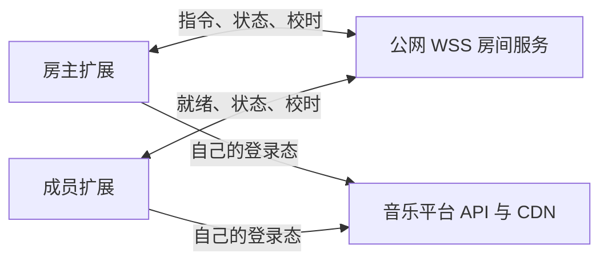

# 一起听：可行性与建议方案

调研日期：2026-10-23。本文是基于当前仓库和官方文档的设计建议，尚未实现房间服务，也未实测多人同步精度。

## 结论与首版范围

**可行，建议采用「服务端同步播放状态、每位成员独立获取音源」的方案。** 现有 Provider、播放器和 Media Session 可以复用；主要工作是播放器控制入口改造、房间协议及服务部署，属于跨前后端功能。

评审结论：总体架构可以进入原型验证，正式接入前应先确定房间与本机状态的边界、媒体就绪判定、房主缓冲恢复、个人缓存隔离及重连身份。主要风险集中在这些状态转换；接通 WebSocket 本身不能证明一起听已可用。先验证同步和异常恢复，再完成播放器控制与缓存改造，最后接入真实 Provider 和房间界面。

建议首版支持桌面 Chrome 扩展、2–5 人私密房间、房间码加入、房主控制播放 / 暂停 / 跳转 / 切歌 / 队列，成员独立调音量。加入中的成员先自行获取音源，再追上房间进度。首版以相同 Provider + 歌曲 ID 播放为前提。

暂不包含跨音源自动匹配、语音聊天、平台官方「一起听」房间互通、房主转移，以及关闭扩展页面后继续播放。移动网页可作为后续兼容目标，不能承诺锁屏后持续接收同步指令。

房主刷新后在宽限期内恢复原身份属于首版重连能力，不属于房主转移。成员主动暂停后保持暂离，只有用户主动恢复同步才重新跟随。

## 当前代码具备什么，缺少什么

| 位置 | 现状 | 对一起听的影响 |
| --- | --- | --- |
| `client/composables/player.ts` | 模块级 `new Audio()`，已有取源、播放 / 暂停、跳转、切歌和队列 | 可复用播放引擎；需拆开准备音源和开始播放 |
| 同上 | `ended` 自动切歌，本地生成随机顺序，`setPlayQueue()` 会立即播放 | 房间中只能由房主决定下一首，成员不能各自随机和自动切歌 |
| 同上 | `sourceRevision` / `playIntent` 阻止过期取源及播放请求 | 可沿用，并增加房间版本与本次播放实例标识 |
| 同上 | 扩展模式 `loadQuality()` 设置媒体源后即返回，`setPlaying()` 在内部处理播放失败 | `await` 返回不代表媒体已就绪或已播放；房间接入需要明确的成功、受阻、失败及过期结果 |
| `client/components/MusicPlayer/components/player-controls.ts` | 切音质保存旧进度，加载后恢复 | 房间模式加载结束后须重新计算目标进度，不能恢复加载前的旧时间 |
| `client/composables/media-session.ts` | 系统媒体按键直接调用播放器函数 | 页面、右键菜单、队列和系统媒体按键都要经过同一控制入口 |
| `client/composables/player-persistence.ts` | 持续监听队列、位置和音量，在暂停、seek、页面隐藏时刷盘 | 仅备份内存不足以保护个人队列；接入前先隔离房间数据与个人缓存写入 |
| `shared/utils/providers/` | 按本机登录态获取第三方音源 | 每位成员仍使用自己的会话；可能有人不能播放 |
| `shared/types/music-info.ts` | `MusicInfo` 可以携带 `src`，`SourceInfo` 包含 URL / 请求头 | 不能直接把这些对象序列化发送到房间，必须定义独立的允许字段集合 |
| `entrypoints/background.ts` | 只处理打开页面和扩展安装 | 当前没有后台音频或房间连接；关闭应用页会停止播放 |
| `vite.config.ts` / `package.json` | Nitro 插件已注释，无 `dev` 脚本，服务端测试项目也已注释 | `server/` 虽存在，当前默认构建并未接入它；需要补服务端启动、构建和部署 |
| `nitro.config.ts` | 未启用 WebSocket | 需增加配置及路由，先验证当前安装版本的运行行为 |

注意：README 和部分旧笔记仍描述 Vite + Nitro 一体构建，实施时应以当前配置为准。

扩展模式直接让媒体元素加载 CDN，能够利用浏览器缓冲和 Range；非扩展模式目前会先下载完整 Blob，再设置媒体源。因此网页模式的首次加载等待可能更长，需要单独验证。

## 为什么推荐 WebSocket 房间服务



| 方案 | 判断 |
| --- | --- |
| WebSocket + 集中房间状态 | 推荐：双向小消息，服务端统一排序，重连容易取得完整快照 |
| SSE + HTTP 指令 | 也可行，但要维护两条通道，本场景没有明显收益 |
| WebRTC DataChannel | 状态同步不需要它的媒体传输能力；仍需信令，增加连接协商与网络穿透工作 |
| 房主转发音频流 | 改变现有取源与播放模型，带宽和兼容性成本更高，首版不采用 |

WebRTC 仍需要交换信令来建立连接，参见 [MDN WebRTC connectivity](https://developer.mozilla.org/en-US/docs/Web/API/WebRTC_API/Connectivity)。因此它不能直接解决「完全没有服务端」的问题。

当前安装的 Nitro 是 `3.0.260903-beta`，本地类型声明已有 `features.websocket`。官方文档提供 `features.websocket: true` 和从 `nitro` 导入的 `defineWebSocketHandler`，可优先复用，见 [Nitro WebSocket](https://nitro.build/docs/websocket)。具体配置与运行结果仍须以该已安装版本的最小实验确认，不能直接照搬 Nitro 2 的教程。

建议给房间服务增加独立运行 / 构建入口，与 WXT 分开部署，不必为此同时恢复整个网页代理部署。异地成员需要共同可访问的公网 HTTPS / WSS 地址，仅运行某个人电脑上的 localhost 不够。

首版用一个常驻 Node 进程和内存房间即可，重启后房间失效并明确提示用户。上线前确认反向代理允许 WebSocket Upgrade、长连接超时与 TLS；普通短时 HTTP 函数不能默认视为适合房间服务。多实例以后再加房间归属、共享存储及广播；仅加 Redis 发布订阅不能代替房间指令的统一排序。

服务器只传控制消息，不承担音乐流量，资源需求主要随在线连接数、队列大小和消息频率增长；实际费用取决于部署平台和规模，本次未估算报价。

## 同步协议和进度计算

### 房间状态与本机状态

两类状态独立维护，不能用一个 `playing` 布尔值同时表达：

| 状态层 | 建议状态 | 作用 |
| --- | --- | --- |
| 房间时间轴 | 准备中、预约开始、播放中、暂停、结束 | 服务端决定当前曲目、目标位置和是否推进时间 |
| 本机播放 | 加载中、就绪、跟随中、缓冲中、主动暂离、播放受阻、不可播放 | 描述成员实际能否及是否愿意跟随；连接状态另行记录 |

房间播放中不代表每个成员已发声。本机只有在当前实例播放成功且误差达标后才能显示「已同步」。主动暂离或自动播放受阻时，不执行自动播放和漂移校正；房间切歌、重连或恢复前台都不能清除主动暂离意图。暂离意图应在当前房间会话的页面刷新后保留。

### 权威状态、版本与指令

服务端保存一份权威状态，房主提交意图，服务端验证权限后生成新版本并广播。建议至少包含：

- 房间实例标识、协议版本、单调递增的控制状态 `revision`、房主身份；成员状态独立更新。
- 队列项目的唯一 `queueItemId`、`provider`、歌曲 `id` 和必要展示字段。
- 本次播放的 `playbackId`：重复播放同一首时也变化，避免旧的取源 / 就绪消息污染新播放。
- `status`、用户播放意图、暂停原因、`positionAtAnchor`、`anchorServerTime`、`rate`、当前队列项目、播放模式。
- 指令 `commandId`、预期版本及确认 / 拒绝结果，用于去重与处理过期操作。
- 成员 `memberId` 和服务端分配的连接代次，用于区分重连后的有效连接；恢复凭据仅交给本人，不进入广播快照。

`revision` 只随队列、曲目和时间轴等控制状态变化；心跳、在线状态和成员就绪通知不推进它，避免成员状态更新使房主操作频繁过期。就绪、缓冲和结束通知须携带对应版本、播放实例及连接代次，由服务端验证后决定是否修改房间状态。同一首内的 seek / 暂停也必须使旧预约和旧恢复任务失效，不能只检查 `playbackId`。

首版客户端串行提交控制指令，确认后再基于新版本发送下一项；拖动进度仅发送最终位置，合并尚未提交的重复 seek。发生版本冲突时取最新快照，取消已不适用的意图并反馈，不能静默丢弃或无条件重试旧操作。服务端在有效会话内按成员及 `commandId` 去重并返回原处理结果，去重记录设置上限和有效期。重连后以快照为准，不自动重放断线前未确认的操作。

### 校时与媒体就绪

进度单位统一为秒，时间戳统一为毫秒。播放时目标进度为：

```text
目标进度 = positionAtAnchor
         + (估计的当前服务器时间 - anchorServerTime) / 1000 * rate
```

暂停时保持锚点进度；预约开始前保持起始位置，不将负的时间差代入公式，也不提前播放。不能直接相信客户端 `Date.now()` 相同，也不能收到一次网络消息就认定两端同时播放。通过多次往返校时取低 RTT 样本估计偏移，本地用 `performance.now()` 推进估计；重连、恢复页面和系统唤醒后重新校时。服务端也应使用一致、不会因系统时钟校准而跳变的时间基准，重启后创建新的房间实例。

`ready` 是针对指定播放实例和目标位置的媒体就绪状态：取源成功、元数据有效、目标位置可定位、所需 seek 已完成，并具备开始播放所需的数据；不能仅凭 Provider 返回或 `audio.load()` 调用完成就上报。就绪不保证后续永不缓冲，也不代表自动播放已获准。准备流程必须可取消、有超时，并明确返回就绪、失败或过期；开始播放另行返回成功、受阻、失败或过期。准备过程中收到新状态时重新核对版本与目标位置。

建议流程：

1. 用户点击加入，服务器返回最新状态；客户端在用户操作中尝试启用播放，并独立解析音源。
2. 客户端上报 `ready`、等待、自动播放受阻或无权限。已有房间继续播放，新成员准备好后追上；首播 / 切歌时房主就绪即可启动，其他人晚到追上，避免一人拖住所有人。
3. 服务端根据房主的就绪与指令发布带未来开始时刻的状态；允许跟随且已就绪的客户端预先 seek，在约定时间尝试播放，实际启动后再校正。迟到或尚未就绪的客户端按最新时间轴追赶。房主启动受阻或失败时上报并冻结房间时间轴，不能一直显示正在播放。
4. 跟随中的客户端周期性比较 `audio.currentTime` 与目标位置，按误差修正；前台恢复和重连后立即拉快照，再按本机状态决定是否追赶。切音质、重新取源和缓冲恢复也重新计算目标位置，不恢复加载前的旧进度。
5. 成员音频结束后等待房间决定，不能本地切歌。房主的实际结束事件推动服务端更新下一首；歌曲加载失败时显示失败，不声称已经播放。

### 漂移校正与验证指标

最小原型先使用可调误差阈值触发 seek，并设置冷却，验证完整状态流程；稳定后再比较倍速微调是否改善听感。倍速策略的实验起点可以是：误差小于约 150ms 不处理，150–500ms 用 `0.98–1.02` 倍速追赶，大于 500ms 才 seek，配合滞回避免反复切换。

上述倍速只有约 2% 的追赶速度：消除 300ms 偏差理论上需要约 15 秒，500ms 需要约 25 秒，不能假设它会快速恢复同步。实验须设置最大微调时长、退出误差阈值和超时后的 seek 策略；具体数值根据恢复耗时与听感决定。所有校正都受当前 `revision` / `playbackId` 约束；暂停、缓冲、seek、换歌、暂离和退出时取消旧校正并恢复基准速度。临时倍速是本地校正，不广播成房主改速；首版房间基准速度固定为 1。

`playbackRate` 可调速，浏览器提供音高校正，见 [MDN playbackRate](https://developer.mozilla.org/en-US/docs/Web/API/HTMLMediaElement/playbackRate)。这种方法仍需测听感、seek 延迟和设备表现。蓝牙等输出延迟不包含在 `audio.currentTime` 里，不能把媒体进度接近等同于扬声器真正同时发声。

建议把「稳定网络下，稳态两端媒体时间差 P95 ≤ 300ms」作为原型的候选门槛，尚未实测，不是现有能力或精度承诺。测量时记录客户端媒体时间、对应校准时刻及校时不确定性，统一换算到同一时刻比较，不能按遥测到达服务端的时间直接相减。

| 指标 | 统计约定 |
| --- | --- |
| 稳态误差 | 同一播放实例、双方正常跟随时的绝对媒体时间差 P50 / P95；同时记录采样频率、设备、网络条件和稳态样本占比 |
| 恢复耗时 | 加入、切歌、跳转、重连后，到实际播放且连续多次采样误差达标的耗时；记录超时和失败，不只统计成功样本 |
| 校正干扰 | 每分钟硬 seek 次数、倍速微调持续时间，结合听感判断是否过度校正 |
| 不可同步时间 | 单列缓冲、播放受阻、取源失败及断线时长；主动暂离另列，不能将异常全部排除后只报告稳态指标 |

恢复耗时门槛和采样窗口在静态音频实验后确定，并在真实 Provider 测试中单独报告取源等待。媒体时间指标不能证明实际出声同步，同一房间多台扬声器无回声的精确同步不在首版目标内。

## 音源与浏览器限制

### 各自的播放权限和内容一致性

房间只能同步歌曲身份与进度，不能让成员继承房主的登录、会员和地域权限。当前网易云 Provider 已将 `freeTrialInfo` 映射为「试听」音质，QQ 对无可用音质返回错误；房间需把这些结果展示为成员不可同步的原因。

建议 Provider 增加结构化的完整 / 试听 / 不可播放状态及可用区间，避免依赖「试听」文案判断。时长比较只能辅助发现差异，不能证明音频内容一致；完整曲和从歌曲中段开始的试听片段不能按同一时间轴同步。

首版不自动用另一个音源替换：不同版本、前奏、静音、现场录音会导致同一个时间点对应不同内容。队列共享仅发送白名单字段，**不发送 `src`、`SourceInfo`、签名音频 URL、Cookie、第三方请求头或登录凭据**。每台设备继续通过既有 Provider 和 `shared/utils/fetch.ts` 获取第三方数据。

### 自动播放与系统媒体控制

加入房间应提供明确的「加入并播放」操作，但一次点击不能保证后续异步播放都被浏览器放行。必须处理 `play()` 的拒绝，提示用户再次点击继续，而不是把受阻成员标记成已同步。脚本调用也受自动播放策略约束，见 [MDN play()](https://developer.mozilla.org/en-US/docs/Web/API/HTMLMediaElement/play)。

Media Session 的房主操作应生成房间指令。普通成员在页面或系统执行暂停 / 停止时应允许本机暂停并标记「暂离同步」，再次主动播放时追到房间当前位置；不能拦住系统暂停，也不能让成员暂停意外暂停整个房间。自动校正不得重新启动主动暂停的成员。成员的切歌 / 跳转等房间控制在首版不可用，界面给出房主控制提示。

### 后台、锁屏和关闭页面

Media Session 提供系统媒体控制，不是 JavaScript 后台运行保证。页面被冻结后，定时器等任务可能停止，因此 WebSocket、Worker 或高频计时器都不能保证移动浏览器锁屏后持续同步。见 [Chrome Page Lifecycle](https://developer.chrome.com/docs/web-platform/page-lifecycle-api)。需要在恢复后补快照、重新校时和追赶进度；长期后台可靠同步需要单独评估原生容器及目标系统后台能力。

桌面扩展若后续要求「关掉应用页仍在房间播放」，需将音频引擎迁到 offscreen document，并设计消息控制、会话恢复和 Media Session 所在上下文。Chrome 的 `AUDIO_PLAYBACK` offscreen 在连续 30 秒没有音频播放后会关闭，暂停房间也要能正确恢复，见 [Chrome Offscreen API](https://developer.chrome.com/docs/extensions/reference/api/offscreen)。

Chrome 116 起 service worker 可通过 30 秒活动窗口内交换 WebSocket 消息延长存活，见 [Chrome 扩展 WebSocket](https://developer.chrome.com/docs/extensions/how-to/web-platform/websockets)。这只能用于连接管理，不能直接把需要 DOM 的 `Audio` 放进 service worker，也不适用于普通移动网页。首版仍将音频和连接保留在应用页，暂不同时进行后台播放重构。

## 失败与重连策略

### 断线、身份恢复与多窗口

- 连接健康：使用应用层心跳和响应超时识别静默断网，不能只等 WebSocket 的关闭事件；明确心跳周期、判失联阈值与宽限期的关系。重连使用有上限的指数退避并加入随机抖动，恢复页面时立即检查连接健康。
- 成员断线：显示同步已断开，允许当前歌曲短暂继续；从最后一次有效服务端响应起，超过宽限时间（建议先试 20 秒）本机暂停。重连取最新快照，丢弃旧指令，不补播断线期间的切歌序列；此前主动暂离的成员继续暂离。
- 房主断线：服务端冻结控制，宽限期内保持当前时间轴；超时结束房间并通知在线成员暂停。客户端即使没收到结束通知，也应用自己的超时规则。房主在宽限期内恢复后先取快照、校时并准备媒体，再恢复控制，不能用刷新后的默认播放器状态覆盖房间。
- 身份恢复：加入时签发绑定房间实例与成员身份的随机恢复凭据，按需设置有效期并保存在本机，使刷新可恢复原成员身份；房主权限由服务端已有成员记录决定，不能凭房间码或客户端自报角色获得。离开、房间结束或凭据过期后撤销恢复能力。首版不自动选新房主。
- 房间服务重启或房间过期：明确提示失效，停止应用远程状态，保留退出及恢复个人队列的入口。
- 多窗口：每个客户端会话只允许一个窗口作为房间播放器，本机使用窗口协调机制避免重复发声。恢复连接后服务端提升连接代次，撤销旧连接的控制权；旧消息及迟到的关闭事件不得影响新连接或触发房主离线。第二窗口默认提示已有播放窗口，接管时明确通知旧窗口停止；服务端连接代次不能替代本机音频互斥。

### 缓冲、启动失败与恢复

成员缓冲 / 无权限时展示本机状态，其他成员继续；恢复后仅在仍允许跟随时 seek 追赶。房主缓冲需要全房间处理，但不能把每次 `waiting`、换源或 seek 都直接映射成全员暂停。

建议保留用户播放意图，并单独记录暂停原因（用户暂停、房主缓冲、启动受阻或失败）。预期换源 / seek 使用准备流程；播放中持续缺少缓冲经过可调确认窗口后，房主才上报缓冲事件。服务端接受后，把当前权威时间轴在接受时刻的位置固定为暂停锚点并广播；房主就绪后也追到这个共同锚点，再重新预约开始。此选择可能让房主略过缓冲期间未听到的片段，应在原型中验证可接受性。

自动恢复必须同时满足：用户仍希望播放、暂停原因允许自动恢复、连接及版本有效、目标位置媒体就绪。房主被暂停后可能不会产生 `playing` 事件，因此准备阶段应根据媒体就绪条件判断，`playing` 只用于开始后的确认。房主手动暂停、切歌、seek 或断线时取消旧恢复任务，迟到的 `ready` 不能重新启动房间。自动播放受阻须由用户操作解除；失败或超时保持明确错误态，不能无限等待或循环重试。

## 个人缓存隔离与退出恢复

缓存隔离是接入真实播放器的前置工作。当前持久化模块会持续观察播放状态并延迟写入，暂停、seek 和页面隐藏还会触发刷盘；只在内存里保存入房前快照，仍可能让房间队列覆盖个人缓存。

建议明确区分个人会话与房间会话的持久化范围：

1. 切入前协调缓存初始化与正在进行的写入，保存当前个人队列、位置、播放模式及随机顺序；完成保存或明确处理保存失败后，再切换房间会话。失败时提示无法保证刷新后的个人状态恢复，不静默宣称已保存。
2. 房间期间不把房间队列和位置写入个人缓存；音量仍作为本机偏好保存。房间身份、恢复凭据和主动暂离意图独立存放，房间播放状态在重连后以服务端快照为准。
3. 入房失败、主动离开或房间失效后恢复个人队列和位置，默认保持暂停；不能调用会自动播放的 `setPlayQueue()` 完成恢复。
4. 切换会话时阻止旧异步恢复和延迟写入跨越会话边界；刷新、页面关闭或异常终止后，仍能从持久化的个人状态恢复，不能依赖退出事件必然执行。

## 改动边界与验证顺序

建议新增 `shared/types/listen-room.ts`（协议）、`server/utils/listen-rooms.ts`（房间状态机）、`server/routes/listen-ws.ts`（连接）、`client/composables/listen-room.ts`（连接 / 校时 / 重连），以及房间入口与成员面板。路径是建议，实施时再确定。

最重要的改造是给播放器增加「用户控制意图」入口和「应用远程状态」入口，并将媒体准备、定位和播放结果显式返回给房间控制层。远程状态内部产生的 `pause` / `seek` / `load` 事件不能反过来广播成新命令，否则会形成回声循环。音质切换、错误重试、页面快捷键、队列操作及 Media Session 都要检查，不能只改主播放按钮。个人模式保持原行为，房间队列应用与个人状态恢复均不能直接调用会自动播放的 `setPlayQueue()`。

服务端须验证成员身份、房主权限、消息大小和队列上限；短房间码需要限流、有效期，管理能力另用随机令牌。WebSocket 不依赖 CORS 保护，应验证握手来源并独立鉴权；浏览器原生 WebSocket 不能随意附加 Authorization 请求头，可在首条消息认证，认证前不下发房间信息，设置超时，避免把长期令牌放进 URL 日志。房间 HTTPS 请求走现有请求封装并显式 `credentials: 'omit'`，使用房间凭据。

部署域名确定后核对扩展的 HTTPS 主机权限和实际生成 manifest 的 CSP `connect-src` 是否允许 WSS；两者分别验证，不能把第三方音乐平台的 DNR 请求头规则套到房间服务上。首版优先输入房间码，避免邀请链接依赖每台开发机器上不同的扩展 ID。

建议分四步验证，每步通过后再扩大范围：

1. **最小同步与恢复实验**：独立启动 Nitro WebSocket，用同一段已获授权的静态音频连接两端，验证校时、预约播放、阈值 seek、主动暂停、模拟房主缓冲、启动受阻和重连。按上述口径记录误差、恢复耗时及失败，再比较倍速策略；先验证状态流程，不先制作完整房间界面。
2. **播放器控制与缓存隔离**：统一所有控制入口，拆开媒体准备与播放，接入版本取消和明确结果；隔离个人缓存与房间会话。验证个人模式回归、成员不自行切歌、系统暂停、旧异步任务取消，以及加入过程中刷新、房间内关闭页面和退出恢复。
3. **接入真实 Provider**：先接一个 Provider，覆盖异步取源、音质切换、试听、无权限、音源失败和缓冲恢复；确认取源等待与同步恢复分别可观测后，再覆盖其他音源。首版只允许已确认可使用共同完整时间轴的音源跟随，试听或无法确认时明确显示不可同步。
4. **房间产品与部署**：完成加入 / 退出、成员状态、房主权限、心跳超时、恢复凭据、限流和多窗口协调，在公网两台设备实测刷新接管、静默断网与服务重启。后台和移动端继续作为单独验证项。

新增有价值的测试集中在时间换算、状态机、指令去重 / 过期、连续控制冲突、旧取源取消、缓冲后手动暂停阻止自动恢复、房主断线、旧连接失效、个人缓存隔离和成员不擅自切歌。当前服务端 Vitest 项目未启用，需补独立测试入口；保留前端类型检查和客户端回归。浏览器实测至少覆盖：连续播放与换歌、拖动进度、晚加入、刷新、断网重连、音源失败、试听差异、音质切换、系统暂停与恢复、页面前后台切换及多窗口接管。

开发量不能按「接一个 WebSocket」估计：原型的重点是测同步模型；正式首版的主要成本在现有播放器控制与异常恢复。先完成两端实验，才能根据实测结果给出可信的排期和同步精度目标。
